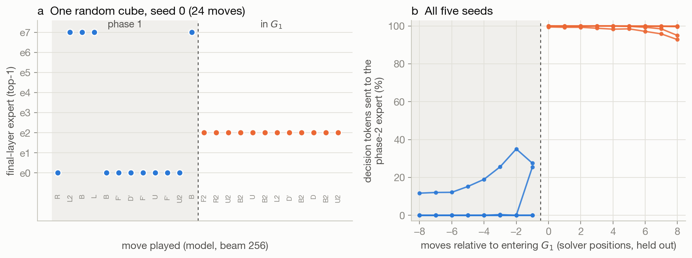
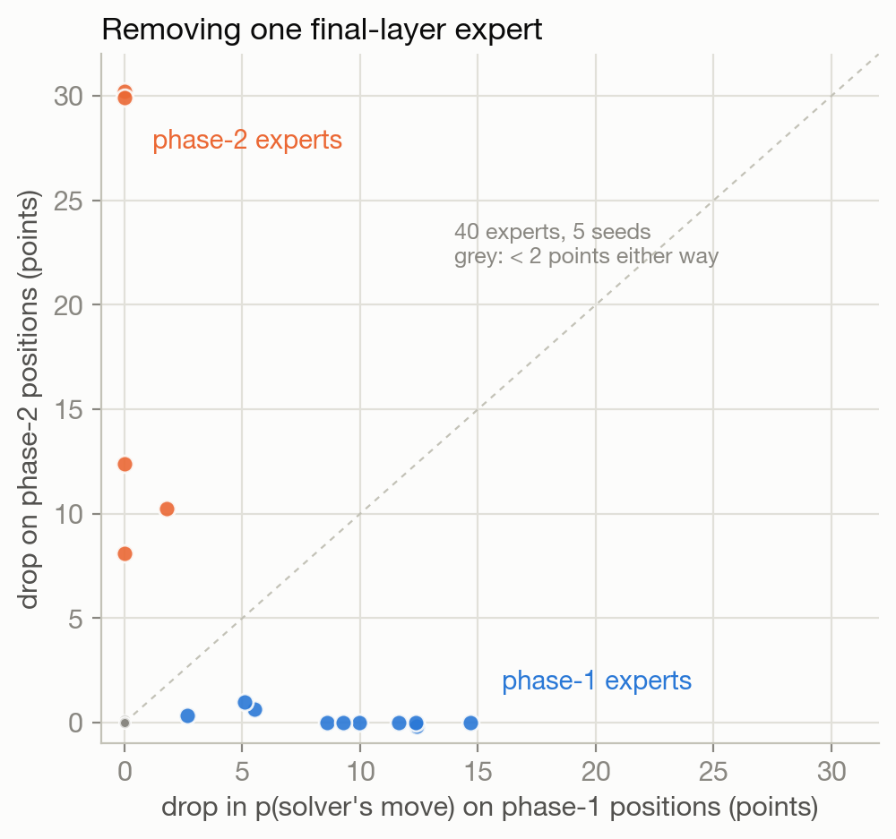

# Mixture-of-experts layers in a learned Rubik's cube solver split along the solver's phases

**Ali Tayeb** · October 2026 · [code, data and checkpoints](https://github.com/alityb/cubemoe)

> **Summary.** I trained small Mixtral-style mixture-of-experts (MoE) transformers to imitate a two-phase Rubik's cube solver, without ever showing them which phase a position belongs to. With beam search, all five models solve 500 out of 500 uniformly random cubes, in solutions about as long as the solver they imitate. In all five, the experts in the final layer that matter divide cleanly by phase: removing a phase-1 expert costs 3–15 points of accuracy on phase-1 positions and at most 1.8 on phase-2 positions, and the reverse holds for phase-2 experts. The router reads the phase along a single linear direction, and steering its input along that direction moves the model onto phase-2 moves in four of five seeds (a random direction does nothing). The same models show that this kind of evidence is easy to get wrong: earlier versions of this project produced convincing routing results from models that could not solve the cube at all. A pre-registered test on OLMoE-1B-7B, a 7B-parameter MoE language model, finds routing patterns consistent with the cube results, but the absolute effects there are small. Models trained the same way on CFOP solutions also solve every random cube tested and demonstrably follow CFOP's stage order, but their experts do not divide by stage: routing tracks which algorithm is being executed, and two pre-registered attempts to explain the difference failed. I read this as evidence that MoE routers can recover a decomposition that is latent in their training data, in a setting where the decomposition is known exactly, and not as evidence about what experts in large language models specialise in.

---

## 1. Why a Rubik's cube

Mixture-of-experts layers route each token to a few of many feed-forward "experts." Whether those experts specialise in anything meaningful is an open question, and recent work has made it more open, not less. Routers carry token-position information ([Bershatsky & Oseledets, 2025](https://arxiv.org/abs/2504.04444)), observational routing statistics do not predict which experts matter when removed ([Engmann et al., 2026](https://arxiv.org/abs/2606.10703)), and a pre-registered causal study of a 218B-parameter MoE found that most apparent expert "families" are not selective once the measurement is controlled ([Salomone et al., 2026](https://arxiv.org/abs/2606.25092)).

All of these studies share a limitation: in natural language there is no ground truth for what the experts *should* specialise in. Labels like "math" or "Arabic" are reasonable guesses, not facts about the model's training distribution. When a study finds weak specialisation, it cannot tell whether the specialisation is absent or whether it is organised along lines nobody thought to test.

Cube solvers remove that ambiguity. Kociemba's two-phase algorithm ([Kociemba](https://kociemba.org/math/twophase.htm)) splits every solve at an exactly defined point. Phase 1 brings the cube into the subgroup

$$G_1 = \langle U, D, R2, L2, F2, B2 \rangle,$$

the positions solvable with only those moves, and phase 2 finishes inside $G_1$. Whether a position is in $G_1$ is a deterministic function of the cube, and phase-2 solutions never use quarter turns of R, L, F or B. A model trained on such solutions has a known decomposition in its data. The question is whether its router finds it.

**Contributions.**

- A test bed with exact ground truth for MoE specialisation: cube-solving data with a known two-phase decomposition, released with code and 10 trained checkpoints.
- Evidence that production-style MoE models which genuinely solve the cube divide their final-layer experts along the phase boundary, replicated across 5 training seeds, with causal (knockout) evidence and controls for the main confounds.
- A mechanism, in all five seeds: the router reads the phase along one linear direction, the phase-2 expert enforces phase 2's move set, and steering the router along that direction changes the moves.
- A matched negative: models trained on CFOP solve the cube and follow CFOP's stages, but their experts track which algorithm is running, not the stage. Two pre-registered explanations of the difference failed.
- A record of how this kind of evidence goes wrong, including a full set of earlier results that came from models that could not solve the cube.
- A pre-registered test of three routing predictions on OLMoE-1B-7B.

## 2. Setup

**Data.** I use a reimplementation of the two-phase solver that finds an optimal phase-1 solution followed by an optimal phase-2 solution, checked against the `kociemba` Python package. It generated 250,000 solves (5.1M position–move pairs), half from uniformly random cubes and half from cubes 1–12 random moves from solved. On 100 random cubes the solver's solutions average **23.2 moves** (sd 1.2). This is longer than the full Kociemba algorithm, which keeps searching for shorter solutions.

Every dataset passes automated checks before training: solutions replay to solved, labels match a recomputation from the cube state, there are no duplicated scrambles, and the solver's move choices show no repetitive patterns. These checks caught two data bugs in earlier versions, each of which would have produced a convincing but wrong result.

**Augmentation.** Rotating the whole cube about its up–down axis, or turning it upside down, maps $G_1$ onto itself. These 8 rotations therefore map a two-phase solution onto another valid two-phase solution with the phase boundary at the same step. I verified this on 1,600 rotated solutions: all still solve the rotated cube and all keep the boundary at the same step.

**Model.** A Mixtral-style MoE transformer ([Jiang et al., 2024](https://arxiv.org/abs/2401.04088)): 6 layers, width 256, 4 attention heads, RMSNorm, rotary position embeddings, QK-norm, and SwiGLU experts. Every layer has 8 experts with top-2 routing, a load-balancing loss and a router z-loss, about 35M parameters in total. The input is the current cube (54 sticker colours plus a decision token) with bidirectional attention, and the output is the next move. The model is never given the phase.

**Training.** 60M position–move examples per model (about 12 passes over the data), AdamW, cosine schedule, bfloat16, on one L40S GPU (about 3.6 hours). Five seeds.

**Solving.** Beam search over the model's move probabilities. At each step it keeps the 64, 256 or 1,024 most probable move sequences, removes duplicate positions, and stops at the first solved cube or after 40 moves. Test cubes are 500 freshly sampled uniformly random cubes.

## 3. The models solve the cube, and the model does the work

| | seeds 0–4 |
|---|---|
| next-move accuracy on held-out solver positions | 72.8% ± 0.6 |
| solved, no search (always take the most likely move) | 5.1% ± 2.5 |
| solved, beam 64 | 479–499 of 500 |
| **solved, beam 256** | **500 of 500 in every seed**; 23.8 ± 0.2 moves |
| solved, beam 1,024 | 500 of 500 in every seed; 22.6 ± 0.1 moves |
| the solver the models imitate | 23.2 moves |

The model needs search: on its own it solves only about 5% of cubes. To check that the search is not doing the solving, I ran the same beam search with no model (all moves equally likely, width 1,024) and with an untrained model of the same architecture (width 256). Neither solved any of 30 random cubes; the trained model solved 60 of 60. Along the trained model's solutions, the move taken was its own first choice 86% of the time, its second choice 8%, and its third 3%. The search mostly recovers from occasional mistakes. None of the 500 test cubes appears among the 26.9M distinct training positions, counting rotations.

Attention matters, in every seed. Removing it from every layer drops next-move accuracy from 72–74% to 3–12% and the solve rate to 0%. Replacing it with a uniform average over all stickers drops accuracy to 2–11%. Removing it from the first layer alone drops accuracy to 3–7%.

## 4. Experts in the final layer divide by phase

*Figure 1. (a) One random cube solved by seed 0 with beam 256, in 24 moves. Each dot is the final-layer expert the decision token is sent to first, at each move; the dashed line marks where the cube enters $G_1$. Phase 1 uses e0 and e7. From the first $G_1$ position on, every move goes to e2, and every move the model plays there is a $G_1$ move. (b) Share of decision tokens sent to each seed's phase-2 expert, by distance from entering $G_1$, over 600 held-out solver solves. After entry it is 93–100% in every seed. Before entry it is about 0% in seeds 2–4; seed 0 reaches 25% only on the last step before entry, and seed 1 sends 12–35% of late phase-1 positions to its phase-2 expert.*

**Routing.** At the final layer, the expert chosen for the decision token carries information about the phase even among positions the same number of moves from solved. Phase explains 21.9% ± 4.0 of the router's choice (range 17.8–27.1%), against 0.0% for a router with its choices shuffled within the same distance. In every seed one expert takes most phase-1 positions (58–81%) and almost no phase-2 positions (0.0–0.4%).

**Knockouts.** Routing that lines up with a concept does not show the model *uses* it. To test use, I removed each final-layer expert in turn by setting its router score to −∞, so tokens go to their next-best experts, and measured the drop in probability of the solver's move.

| seed | phase-1 experts: loss on phase 1 / phase 2 (points) | phase-2 experts: loss on phase 1 / phase 2 |
|---|---|---|
| 0 | e0: 8.6 / 0.0 · e7: 9.9 / 0.0 | e2: 0.0 / **30.2** |
| 1 | e6: 12.4 / −0.2 | e1: 1.8 / **10.2** |
| 2 | e1: 12.4 / 0.0 · e4: 9.3 / 0.0 | e3: 0.0 / **29.9** |
| 3 | e6: 11.7 / 0.0 · e3: 5.5 / 0.6 · e4: 5.1 / 1.0 | e5: 0.0 / **8.1** |
| 4 | e1: 14.7 / 0.0 · e5: 2.7 / 0.4 | e6: 0.0 / **12.4** |

Every expert whose removal costs more than 2 points is dominated by one phase. The largest effect on the other phase is 1.8 points (seed 1, e1), against 2.7–30.2 on its own phase. Each seed has exactly one phase-2 expert and one to three phase-1 experts. Removing any of the remaining experts costs nothing measurable in either phase.

*Figure 2. Every final-layer expert in all five seeds (40 experts), removed one at a time: drop in the probability of the solver's move on phase-1 positions against the drop on phase-2 positions. Experts that matter sit on one axis or the other; none sits near the diagonal.*

A second causal test, forcing phase-2 positions through the phase-1 expert, does not work in these models. Forcing the phase-1 expert removes 7.5–26% of the probability on legal moves, depending on the seed, but forcing a typical *other* expert removes 4–35%. Forcing any single expert onto the decision token is disruptive on its own, so this test cannot isolate expert identity. I report knockouts instead. The forcing test worked in the earlier, non-solving models (Section 8), and the contrast is a useful warning.

The phase split is not the only structure. Kociemba's phase 1 is itself two of Thistlethwaite's stages: orient the edges, then orient the corners and gather the middle-layer edges. In the four seeds with more than one phase-1 expert, the phase-1 experts divide along that line. Removing one mainly hurts F and B quarter turns, the only moves that flip edges in this convention; removing the other mainly hurts R and L quarter turns, which twist corners without flipping edges. On a scale from −1 (only corner-twisting moves hurt) to +1 (only edge-flipping moves hurt), the phase-1 experts score −0.16 and +0.30 in seed 0, −0.79 and +0.62 in seed 2, −0.92, +0.24 and +0.32 in seed 3, and −0.93 and +0.39 in seed 4. Seed 1 has a single phase-1 expert (+0.25). This analysis is exploratory, and the split is weak in seed 0.

## 5. What the experts respond to

A common worry is that experts are pattern matchers keyed to surface features of the input. Here the answer depends on the layer.

**Experts that process individual stickers start as pattern matchers.** In layer 0, a sticker token's own position and colour explain 92–98% of which expert it goes to, across the five seeds. By layer 5 this is 43–58%.

**The decision token's routing tracks abstract progress, not single stickers.** In the last two layers, its expert choice is explained by phase (47–73% across seeds and layers) and by the number of moves to reach $G_1$ (53–77%), 1.8–2.3 times as well as by the most informative single sticker (25–37%) in every seed. Layers whose routing barely varies are excluded from this comparison, because a share of almost no variation is not meaningful.

**The model represents distance to the goal beyond what the stickers state.** A linear readout of the raw stickers recovers several cube properties perfectly: whether the cube is in $G_1$, and how many edges or corners are misoriented (accuracy or $R^2$ 0.99–1.00). These are effectively counts over individual stickers, so finding them inside the model is not evidence of computation. Two properties are not linear in the stickers: the number of moves to reach $G_1$ ($R^2$ 0.85 from raw stickers) and the number of moves to solve ($R^2$ 0.77). Both are read out better from the model's middle layers, peaking at layer 4 in every seed, at 0.94–0.95 and 0.92. Linear probes show the information is present, not that the model uses it.

## 6. How the router reads the phase, and what the phase-2 expert does

Sections 4 and 5 show that the final-layer router separates the phases and that the experts it picks matter. This section follows the mechanism from the router's input to the move. Everything here concerns the decision token at the final layer, in all five seeds.

**The router reads one linear direction.** Take the router's input, the normalised residual stream, and compute the difference between its mean on phase-2 and on phase-1 positions. Call this the *phase direction*. A linear probe on the router input classifies the phase with 100% held-out accuracy in every seed. More to the point, the router's own preference between its phase-2 expert and its main phase-1 expert, the difference of their two rows of router weights, points along the phase direction: cosine 0.82–0.86 across seeds, against at most 0.13 for random directions (95th percentile). The phase direction alone explains 85–93% of the variance in the router's phase-2-versus-phase-1 preference across positions. The expert labels differ from seed to seed; the geometry does not.

**What the phase-2 expert writes.** Projecting each expert's output through the final norm and the unembedding (direct logit attribution, with the norm's per-token scale held fixed) shows what it does to the move distribution. On phase-2 positions, the phase-2 expert shifts 4.1–4.7 logits from the eight quarter turns of R, L, F and B onto the ten moves that stay inside $G_1$, and raises the solver's actual move by 5.2–6.6 logits. Phase-1 experts barely shift the move class (0.03–0.25 logits). They raise the solver's specific move by 2.2–3.7 logits on phase-1 positions. So the phase-2 expert does two things at once: it enforces phase 2's restricted move set and it picks within it.

**Steering the router changes the moves.** If the router reads the phase along one direction, adding that direction to the router's input on phase-1 positions should make the model behave as if it were in phase 2. I added the phase direction, scaled in units of the phase-1/phase-2 mean difference, to the decision token's router input. There are two versions: *router-only*, where the experts still see the original input, and *full*, where the experts see the shifted input too.

| phase-1 positions pushed toward phase 2 | seed 0 | seed 1 | seed 2 | seed 3 | seed 4 |
|---|---|---|---|---|---|
| probability on $G_1$ moves, unsteered | 45% | 46% | 45% | 45% | 45% |
| router-only, strength 2 | 85% | 53% | 90% | 90% | 92% |
| full, strength 1 / 2 | 98 / 100% | 77 / 100% | 98 / 100% | 89 / 100% | 95 / 100% |
| random direction of the same size, full, strength 2 | 43% | 42% | 46% | 47% | 47% |

Changing only which experts the router picks moves the model's choice onto $G_1$ moves in four of five seeds. The fifth, seed 1, is the exception, and the routing explains why. In that seed the phase-2 expert is already one of the two experts chosen for 89% of phase-1 positions, so steering the router mostly reorders and reweights the experts already chosen rather than bringing in a new one. Full steering works in every seed, and a random direction does nothing in any. The effect runs the other way too. Pushing phase-2 positions toward phase 1 removes the phase-2 expert from the decision token in every seed (98–100% of positions → 0–1%) and drops the $G_1$ mass from 100% to 79–95% with router-only steering. It does not fall to the phase-1 level of 45%, so part of the $G_1$ constraint is carried outside the routed expert.

**Where the phase is computed.** Because the phase is a linear function of the raw stickers (a probe on one-hot stickers is 100% accurate), finding it in the residual stream proves nothing on its own. Two measures are more informative.
- *Separation.* The distance between the phase-1 and phase-2 means, in units of their spread, peaks right after the first layer (d′ 15–26 after the layer-0 MoE or layer-1 attention) and shrinks to 5–8 at the final router's input. Seed 3 builds it one layer later.
- *Exact attribution.* The final router's phase-2-versus-phase-1 logit gap is an exact sum of what each attention head and each MoE layer writes to the decision token (reconstruction error about $10^{-6}$). MoE layers write most of it: the layer-4 MoE contributes 24–36% in every seed and the layer-0 MoE 6–26%. All attention heads together write 25–45%, of which the final layer's own attention contributes 5–15%.

Mean-ablating a single layer-0 attention head removes most of the gap (−3% to 40% retained), but it also cuts next-move accuracy to 23–45%. That is the first point where stickers exchange information, and everything downstream depends on it, so this says little about the phase in particular. Ablating attention in any one of layers 1–4 *increases* the gap (110–127%), except layer 1 in seed 3 (53%). The phase is computed early, then carried forward and rewritten into the router's direction mostly by MoE layers.

These analyses were exploratory. They were developed on seed 0 and then run unchanged on seeds 1–4 (Section 11). Section 7 shows that this clean picture is not what happens in CFOP.

## 7. A second decomposition: CFOP

CFOP, the method most human speedcubers use, solves the cube in four stages: a cross of four edges on the bottom face, the first two layers (F2L, four corner–edge pairs), orienting the last layer (OLL) and permuting it (PLL). I trained five models exactly as in Section 2, on 250,000 CFOP solves (15.3M positions, 61.2 moves on average). The only difference is the augmentation: four rotations that keep the cross face on the bottom.

The CFOP data comes from my own generator, and it is simpler than real CFOP. Each scramble is built backwards from a solved cube: a last-layer case, four F2L pairs and a 4–8-move cross disturbance. The last layer uses only 7 algorithms (Sune, Anti-Sune, F R U R′ U′ F′ for OLL; the T, Ua, Aa and J permutations for PLL). Two of them are chained when one is not enough, and the generator can turn the top layer before an algorithm but never after one.

**The models solve, and they solve the CFOP way.** Next-move accuracy is 87.4–87.9%. With beam 256 every seed solves 500 of 500 held-out scrambles (48.2–48.9 moves). On 200 uniformly random cubes, which the generator never produces, every seed solves 200 of 200 (51.4–52.0 moves). To check the method and not just the result, I measured when each stage is first completed along the model's own solutions:

| | moves | cross done | F2L done | OLL done | PLL length |
|---|---|---|---|---|---|
| CFOP generator (teacher) | 60.5 | 9% | 39% | 61% | 23.5 |
| CFOP models, 5 seeds | 47–49 | 11% | 54–56% | 79–80% | 9.6–10.5 |
| Kociemba model (control) | 23.3 | 99% | 99% | 99% | – |

*Percentages are the point in the solution where each stage is first complete, on 100 held-out scrambles. "First" matters: CFOP algorithms break the cross in the middle and restore it.*

Counted in moves, the models finish the cross, F2L and OLL at about the same points as their teacher (about 5, 26 and 38 moves against 5, 24 and 37). The Kociemba-trained model completes all three only in its last move or two, so the measure separates the two methods.

**But the experts do not divide by stage.** At the final layer, CFOP stage explains 4.5% ± 1.3 of the decision token's routing among positions the same distance from solved (shuffled router: 0.0%), against 21.9% for Kociemba phase. A low ceiling does not explain this. Given the distance from solved, stage carries 0.54 bits against 0.12 for Kociemba phase, so routing had more room to track stage and tracked it less. Routing instead follows the move-level structure:

| what the routing tracks (5 seeds) | share explained |
|---|---|
| which algorithm is being executed | 44.1% ± 2.1 |
| the next move | 32.2% ± 4.6 |
| position within the algorithm | 22.1% ± 2.6 |
| the most informative single sticker | 20.9% ± 7.3 |
| F2L slot / segment | 6.4% ± 2.5 |
| **CFOP stage** | **4.5% ± 1.3** |

Knockouts agree. About four final-layer experts per seed matter (more than 2 points), and 2.4 per seed matter for more than one stage. An important expert puts on average 62% of its damage on its main stage, where 25% would mean no preference. In the Kociemba models the largest cross-phase effect was 1.8 points.

**What the models do instead.** The last layer shows what they learned. On held-out scrambles, 82–87% of the models' last-layer algorithms are among the teacher's 7, but 67–72% of those are performed from a different side of the cube (for example Sune as B U B′ U B U2 B′), which the teacher never does. Performing an algorithm that preserves the first two layers from another side has the same effect as turning the top layer before it and back after it. That supplies the turn-after that the teacher's tables lack, so one algorithm often does what took the teacher two. The models use 2.2–2.3 algorithms per last layer against 3.8. They finish the whole last layer with a single algorithm 14–20% of the time and skip PLL 27–33% of the time (teacher: 1%). This is not ZBLL or any other large algorithm set: the models use only the 7 algorithms they saw. The other-side versions were in the training data through rotation augmentation; the choice of side for each case is the model's.

That choice comes from the model, not the search. At the first move of an other-side algorithm, the model's own top choice is the move the beam played 91–95% of the time. It gives that move a probability of about 0.52, against 0.04 for the first move of the same algorithm from the teacher's side. Over the whole last layer, 98–99% of the moves on the beam's solutions are the model's top choice. Without search the picture splits by stage. The model alone completes the cross on 98–100% of cubes but F2L on only 11–12% of held-out scrambles (3–5% of random cubes), and every failure is a loop. The models have learned the cross and their last-layer algorithms; they cannot plan F2L without search.

**Why the difference? Two failed explanations.** Both models follow their solver's decomposition, but only the Kociemba routers divide along it. I tested two explanations, each pre-registered (predictions committed before running) on the same 10 (solver, variable) pairs.

1. *Routing follows what changes the output:* how much a variable determines the next move should predict how much routing tracks it. Spearman ρ = 0.18; the bar was 0.5. Kociemba phase also determines the next move *less* than CFOP stage (2.3% against 3.5%).
2. *Routing follows the plan:* the same with the next ten moves, and a persistence measure. ρ = 0.14, and persistence pointed the wrong way (ρ = −0.77). Kociemba phase's information about the solver's moves is gone within about three moves.

What decides whether routing recovers a decomposition remains open. One lesson came after the fact. Both tests held distance-to-solved fixed, a quantity the model never sees, and under that conditioning phase looks nearly irrelevant to the output. Yet removing the phase-2 expert, or steering the router, shows it causally constrains the moves. Label statistics measured under a confound control can misstate what a model uses.

## 8. How this goes wrong

This project produced several results that looked right and were not. Each is a mistake other MoE interpretability work can make.

**Interpreting a model that cannot do the task.** For most of the project I studied models that read the starting cube plus the moves made so far. Their next-move accuracy looked reasonable, and their routing showed a clean phase split that passed pre-registered tests. They could not solve a single random cube. One move from solved, where the correct move is fully determined, they picked it 20% of the time. They had learned statistics of the solver's move sequences, not the cube. I found this only when I checked whether the models solve. Every routing result in Sections 4–6 comes from the later models that do.

**Position.** In sequence models, the phase is correlated with how far into the solve a token is. In those early models, a fake router that read only the step index scored inside the real router's range on the standard alignment metric. Every routing number there had to be measured among tokens at the same step.

**Forcing versus removing.** In the earlier models, forcing phase-2 tokens through the phase-1 expert destroyed 29% of legal-move probability, against 0.26% for a typical other expert, which made a clean causal result. In the solving models, the same test is uninformative because forcing any expert is destructive. Knockouts were informative in both.

**Load.** Forcing a set of tokens onto the expert that already handles most of them changes fewer routing decisions, so it does less damage for reasons unrelated to what the expert computes. In the earlier CFOP models this produced an apparent specialisation signal (p = 0.008) that disappeared once the effect was controlled.

**Readouts that prove nothing.** Several cube properties that sound abstract (orientation counts, membership in $G_1$) are linear functions of the input stickers. Probing for them inside a model shows nothing about computation.

**An off-by-one.** For several weeks my analysis read each move's routing one position late. This could only hide alignment, never create it. Fixing it made the scale-replication alignment 31% stronger and changed no conclusions.

## 9. Does this transfer to a language model?

The cube results suggest a simple account: routers follow the current token by default, and experts that matter appear where predicting the next output requires information the current token does not carry. I tested three consequences on OLMoE-1B-7B ([Muennighoff et al., 2024](https://arxiv.org/abs/2409.02060)), the model studied by Engmann et al. The predictions and pass rules were hashed and committed before the model was loaded. I split tokens into *needs-context* tokens, which the model predicts well with full context but not from the last two tokens alone (8,361 tokens), and *local* tokens, which the last two tokens already predict (1,084).

- **A. Routing follows the current token less on needs-context tokens.** Passed in 8 of 8 late layers.
- **B. Removing an expert hurts needs-context tokens more than random noise of the same size does**, compared with local tokens. Passed in 3 of 4 layers (1.75–2.40× vs 0.55–1.34×). It failed in the earliest layer tested, and it was weak in a pilot on a smaller model, Granite-3.1-1B-A400M.
- **C. Memorised text depends most on specific experts.** Passed in 3 of 4 layers, rising to 7.9× the matched noise at the last layer, against about 1.5–2× for prose and code.

The absolute effects are small. Removing one of OLMoE's 64 experts changes the correct token's log-probability by 0.001–0.004 nats on average, because 8 experts are active per token and they substitute for each other. The result concerns where experts matter relative to a matched control, not that any one expert is essential.

## 10. Related work

**Routers and latent structure.** [Dikkala et al. (2023)](https://aclanthology.org/2023.emnlp-main.583/) show that routers recover latent cluster structure in synthetic mixture data. [Nandakumar et al. (2026)](https://arxiv.org/abs/2606.14398) find that on synthetic knowledge tasks, training with the standard losses gives diffuse routing, and clear task–expert alignment appears only with an explicit task-routing loss. Here the phase alignment appears with only the standard load-balancing and z-losses. An obvious explanation is that phase changes the output sharply (phase-2 solutions use 10 of 18 moves), but the two pre-registered tests of explanations of this kind failed (Section 7).

**Expert specialisation in language models.** [Bershatsky & Oseledets (2025)](https://arxiv.org/abs/2504.04444) show that routers use token position. [Engmann et al. (2026)](https://arxiv.org/abs/2606.10703) find that observational routing statistics do not predict which experts matter when removed. [Salomone et al. (2026)](https://arxiv.org/abs/2606.25092) find that apparent modularity in a 218B MoE mostly dissolves under pre-registered causal tests, and their one surviving module (Arabic) concerns the output vocabulary. The cube setting complements these: it can say what the experts should specialise in, at the cost of being a small, synthetic task.

**Learned cube solvers.** [DeepCubeA (Agostinelli et al., 2019)](https://www.nature.com/articles/s42256-019-0070-z) and [EfficientCube (Takano, 2023)](https://arxiv.org/abs/2106.03157) solve the cube reliably with learned networks and search, with near-optimal solutions; EfficientCube, like this work, uses beam search over a learned move policy. The models here are weaker solvers and are not meant to compete (and solution lengths are not directly comparable, since EfficientCube's main results count a half turn as two moves); solving is used to confirm the models are competent before interpreting them. [Gupta et al. (2025)](https://arxiv.org/abs/2512.03400) train dense transformers on optimal solutions and study world-model probes; they do not study routing.

**Algorithmic interpretability.** Probing for an internal world state follows [Othello-GPT (Li et al., 2023)](https://arxiv.org/abs/2210.13382). Thistlethwaite's four-stage algorithm, whose first two stages make up Kociemba's phase 1, gives a second known decomposition to check against.

## 11. Limitations

- **One task family, small models.** Six layers, width 256, 8 experts. Whether anything here holds in large models is untested apart from the OLMoE predictions, where the effects are small.
- **Mixtral-style routing only.** I also implemented an OLMoE-style configuration (64 experts, 8 active), but on the available hardware it trained about 6× slower, so the cube models use 8 experts with 2 active.
- **The models need search.** Without beam search they solve about 5% of random cubes.
- **The decomposition is in the data by construction.** The models imitate a two-phase solver, so the phase structure is present in the training distribution. The claim is that routers recover it, not that they discover algorithms.
- **The analyses in Sections 4–6 were not pre-registered.** The knockout analysis was written after looking at seed 0 and frozen before seeds 1–4 finished training, then run on them unchanged. The OLMoE test in Section 9 was pre-registered.
- **Knockouts test necessity at one layer.** Middle-layer experts are largely redundant: removing any one costs at most a few points.
- **Probes are linear.** They show information is linearly present, not used.
- **The CFOP data is a simplified CFOP.** The generator's cross is a 4–8-move disturbance, not a real cross solve; its last layer uses 7 algorithms with no turn after an algorithm; and its scrambles come from its own case tables. The models do solve uniformly random cubes, but the comparison with human CFOP is loose.
- **CFOP stage and Kociemba phase differ in more than one way** (number of stages, how sharply they constrain the moves, how long they last). Two pre-registered explanations of the routing difference failed, and with two solvers I cannot isolate the cause.

## 12. Conclusion

In a setting where the right answer is known, a production-style MoE that genuinely solves the cube divides its final-layer experts along the phase boundary of the algorithm it learned from, and the division is causally used. The result replicates across five seeds. It is not automatic: models trained the same way on CFOP follow its stages without their experts dividing along them, and I could not explain the difference with either of two pre-registered tests. It also took several wrong turns to establish, and the most important control was the simplest: checking that the model can do the task before interpreting how it does it.

Code, data generators, checkpoints, pre-registration files and every result file are at [github.com/alityb/cubemoe](https://github.com/alityb/cubemoe).

---

### Appendix A. Earlier models

Before the models in this post, I studied sequence models: decoder-only MoE transformers that read the starting cube followed by the moves made so far and predict the next move. Their results were pre-registered (`prereg/`) and passed, but **these models could not solve the cube**. They solved 0% of random scrambles, and one move from solved they picked the correct move 20% of the time (Section 8). I report them because the pre-registered tests passed anyway, which is the warning.

| programme | models | verdict |
|---|---|---|
| H1: routing recovers the Kociemba phase split (confirmatory) | 4 layers, d=128, 25k solves, 5 seeds | Confirmed |
| H1 scale replication | 6 layers, d=256, 250k solves, 5 seeds | Confirmed. Forcing phase-2 tokens through the phase-1 expert cost 0.290 against 0.0011 for other experts (about 270×), 5/5 seeds |
| Routing sweep: does routing slack drive specialisation? | 6 layers, d=256, 5 seeds per arm | Rejected. With top-1 instead of top-2 routing, phase specialisation fell to 9% of its ceiling while the task was still learned |
| H2: routing recovers CFOP stages | 5 seeds | Rejected. The predicted inequality reversed in 5/5 seeds (paired t, p = 0.0005); CFOP stage was 86% determined by token position, which the network gets for free |
| H2b: decorrelate stage from position | 5 seeds | Rejected on the causal leg. Routing alignment with stage appeared (2.4× its null, 5/5 seeds), but there was no causal evidence of use (p = 0.92), and the test was underpowered (observed effect 0.0094 against a detectable 0.0239) |
| H2c: stage-specific causal readout | 5 seeds | No effect, but the test missed its own pre-declared resolution bar |

The full record, including retracted claims, is in `docs/LAB_NOTEBOOK.md`.

### Appendix B. Training and evaluation details

**Model.** `src/model_prod.py`, preset `mixtral`: 6 layers, width 256, 4 heads, 8 SwiGLU experts per layer (hidden width 896), top-2 routing with renormalised weights, RMSNorm, RoPE, QK-norm. Input: a decision token plus 54 sticker tokens, bidirectional attention; the decision token's final state predicts one of 18 moves. Auxiliary losses: load balancing 0.01 · E · Σ f·P, router z-loss 0.001.

**Training.** `modal/prod.py::train_l40s`: 60M examples (58,593 steps of 1,024), AdamW (lr 1e-3, betas 0.9/0.95, weight decay 0.1), linear warm-up over 1,000 steps then cosine decay to 10% of the peak, gradient clipping at 1.0, bfloat16 autocast, one L40S GPU. Kociemba models use all 8 axis-preserving rotations; CFOP models use the 4 that keep the cross face down.

**Data checks.** Before training, each dataset must pass automated gates: every solution replays to solved, stage labels match a recomputation from the cube state, there are no duplicate scrambles, and solver move choices show no repetitive prefixes. The CFOP dataset passes all 9 gates (sha256 `c8a74dc8…`).

**Solving.** `src/solve_fast.py`: beam search over summed log-probabilities. Duplicate positions are merged by hash, keeping the best score, and the search stops at the first solved cube. Move budget: 40 for Kociemba; 90 for CFOP held-out scrambles and 120 for CFOP random cubes. Random cubes are uniform over reachable states (`prod_analysis.random_cubes`, seed 2026).

**Routing shares.** The share of the final-layer decision token's top-1 expert explained by a variable V, among positions with the same number of moves remaining S: [I(E;V|S) − mean over 5 permutations of E within S] / H(E|S). A shuffled router gives 0.0 in every case reported.

**Knockouts.** Set one final-layer expert's router logit to −∞, so tokens fall to their next-best experts, and measure the drop in the probability of the solver's move. Kociemba: 1,200 held-out solves, about 25k positions. CFOP: 1,200 held-out solves, about 73k positions.

**Probes.** Logistic regression (C = 1) or ridge regression (α = 10) on standardised activations of the decision token, 70/30 split by solve.

**Cost.** About $95 of Modal GPU time in October 2026 across three workspaces, covering training, evaluation and path saving for all ten models. All analyses ran on a laptop (Apple M-series, MPS).
